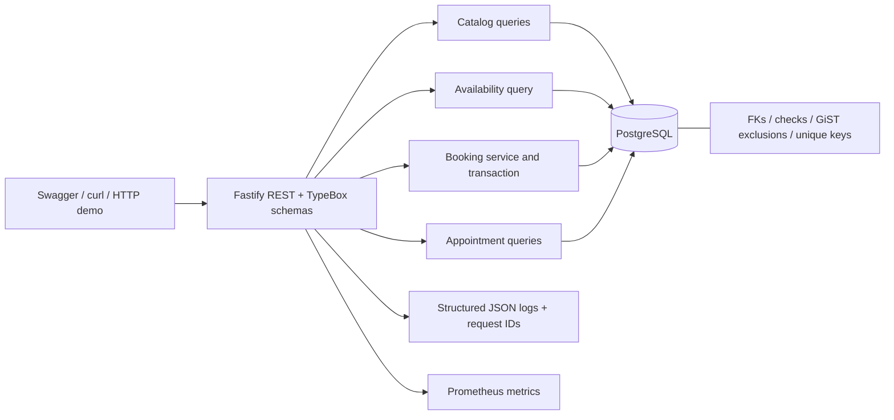
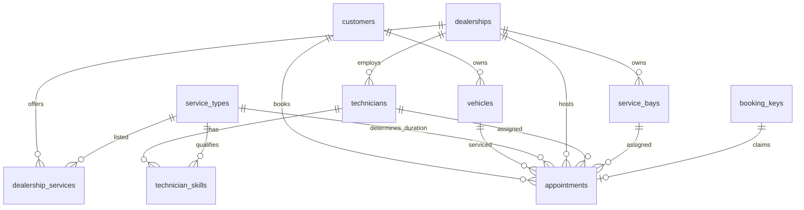

# System design: Unified Service Scheduler

## 1. Problem and scope

Replace manual booking with a REST backend that confirms a customer/vehicle/service/dealership/time request only when one qualified technician and one bay are available for the entire fixed service duration. Persist the assigned resources. Implement the backend fully; OpenAPI, cURL and an executable HTTP demonstration stand in for the client. No dealership integrations are required.

## 2. Assumptions

- A technician and bay each belong to exactly one dealership. Technician skills are many-to-many with service types. All bays support all services. Dealership service offerings are explicit.
- Each technician and bay serves at most one confirmed appointment at any instant. Separate resource pairs may serve concurrent appointments.
- UTC timestamps and UTC date filters; half-open `[start,end)` intervals allow adjacent appointments. Availability uses 30-minute starts as a product assumption; booking is not restricted to that grid. Durations are 1–1440 whole minutes.
- All 24 hours are potentially bookable. Slots can finish next day. No hours, holidays, leave, maintenance, payments, rescheduling or cancellations.
- Past times are allowed for a stable demonstration. Vehicles must belong to the customer; vehicle/customer simultaneous booking prevention is outside scope.
- Only confirmed status exists. Customers, vehicles, catalog and resource management are seeded; there are no administration APIs.
- No authentication is required for this assessment; private appointment APIs are unsafe for public deployment. Demo keys are globally scoped and have no expiry.

## 3. Architecture

The application is stateless. A module owns booking rules and transaction/retry boundaries, schema migrations own integrity, Fastify owns transport and validation. `src/app.ts` creates an injectable app for independent-instance integration tests. `src/server.ts` owns runtime startup and shutdown. `src/db` owns pooling, migration and seed tooling; `src/booking` owns allocation and availability/domain logic.

A modular monolith keeps a short, inspectable transaction across resource allocation and persistence. Splitting services now would introduce coordination and failure modes without a requirement. Multiple instances can share PostgreSQL safely; process memory is never the booking authority.

## 4. Data model

Composite foreign keys enforce `(vehicle_id,customer_id)`, `(technician_id,dealership_id)`, `(service_bay_id,dealership_id)`, `(technician_id,service_type_id)`, `(dealership_id,service_type_id)`, and `(service_type_id,duration_minutes)`. Therefore direct writes cannot bypass vehicle ownership, cross-dealership restrictions, qualifications, offered services or fixed duration. Duration and end are stored with checks so records retain an explicit interval. Catalog duration changes are restricted while referenced; versioned offerings would be needed for future repricing/duration changes.

Two partial GiST exclusion constraints on `tstzrange(start_time,end_time,'[)')` prohibit overlaps for a technician or bay where status is confirmed. `btree_gist` supplies equality support for UUID resources. Ordinary B-tree indexes support catalog and paginated customer/dealership/start-time queries. Primary/unique keys and NOT NULL constraints cover identities and idempotency. Appointment data includes customer and vehicle IDs but not copied names/VINs.

Migration files are checked against persisted SHA-256 digests and applied transactionally under a PostgreSQL advisory transaction lock. This lock serializes schema changes, not bookings. The migrator needs extension/schema privileges; production should use a separate migration role and a less-privileged runtime role. Compose uses one local demo role for simplicity.

## 5. API and booking journey

Discover dealerships → list offered services/durations → request date availability → POST appointment → GET returned Location. The request contains customerId, vehicleId, dealershipId, serviceTypeId and desired startTime. Resources are selected by the server, never supplied by the caller.

The README and generated `/openapi.json` specify all routes, responses, validation and examples. GET /appointments supports bounded dealership/customer/UTC-start-date/status filtering with stable ordering and `hasMore`. Offset pagination is adequate at assessment scale; a cursor on `(start_time,id)` is the future path for deep pages and more stable navigation during inserts.

## 6. Availability

Validate the dealership and offering; derive service duration; generate 48 UTC half-hour starts. A single SQL statement evaluates whether at least one skilled technician and at least one bay have no overlapping confirmed appointment for each full interval. Independent existence checks are valid because every bay is compatible with every service. The statement uses one PostgreSQL snapshot for both resource classes.

The response contains timestamps, booleans and service metadata only. An existing appointment does not make a slot unavailable if another resource pair remains. The answer is advisory: another transaction can book before this client posts. Opening hours and local timezone/DST policy require future product decisions.

## 7. Booking transaction and concurrency

1. Validate transport schemas, canonicalize UUIDs/UTC timestamp and hash a fixed-order request representation with SHA-256.
2. Begin a fresh READ COMMITTED transaction; set statement (5s) and lock (3s) limits.
3. When a key is supplied, insert a `booking_keys` row `ON CONFLICT DO NOTHING`, then lock that row. A competing request with the same key waits for commit/rollback. Inspect the existing appointment: equal fingerprint returns the persisted result (200); unequal fingerprint returns 409. New claims roll back if no booking commits.
4. Verify dealership offering, customer, vehicle ownership and duration.
5. Select the first eligible technician and bay ordered by UUID, excluding overlaps. Use `FOR UPDATE ... SKIP LOCKED` on each resource to reduce concurrent competing inserts. Lock order is consistently technician then bay. Locks last only through this transaction.
6. Insert the appointment, fingerprint and key; PostgreSQL validates every FK/check/unique/exclusion constraint. Commit and return 201. The appointment row is the persisted idempotent result.
7. On an exclusion violation, serialization failure, deadlock or lock timeout: roll back fully, release the connection, and retry from step 2, at most five transactions. The new READ COMMITTED snapshot can select a different resource pair. Never issue allocation SQL in an aborted transaction. Unknown DB failures remain visible; foreign-key races return a reference-changed conflict.
8. If no pair can currently be allocated return 409 NO_CAPACITY. Exhausted retry budget returns 409 ALLOCATION_CONTENTION. Callers use backoff and the same key.

### Why it works

Row locks improve coordination but are not sufficient as the integrity boundary: alternate writers or a stale selection may still race. GiST exclusions check uncommitted competing inserts and enforce whole-interval exclusivity at commit across processes. The unique idempotency index and transactional key claim enforce one successful result per key, including concurrent requests on different app instances. A crash before commit rolls back both claim and booking; after commit, retrying can retrieve the durable result.

### Limits and trade-offs

`SKIP LOCKED` avoids waiting on resource holders but can conservatively return conflict while a short transaction holds otherwise usable resources, including different requested times. A transient conflict therefore does not prove permanent unavailability; clients should refresh/retry. Deterministic ordering is simple but may favor low-ID technicians; fair workload scheduling is future work. Five retries and query limits bound each attempt, not end-to-end latency including pool queues/network failures. Heavy contention still needs admission control, client backoff and load testing. PostgreSQL deadlocks remain possible; they are retried, never assumed impossible. This solution does not claim measured throughput or lock-free behavior.

Keys persist as long as appointments. Keys are case-sensitive; normalized request UUIDs and equivalent timestamp offsets are not. Whitespace or a changed field is handled by schema validation/canonicalization. Global keys must be tenant/principal scoped before authentication is introduced. Failed requests do not bind a key. No exact historical HTTP response bytes are stored; the immutable appointment fields are replayed with explicit 200 status and replay header.

## 8. Scalability, performance and reliability

- Stateless replicas behind a load balancer, per-process pools of ten connections; size replicas/pools against the database connection budget. Exclusion indexes make overlap checks resource-specific.
- One availability statement for a fixed 48 slots; no public customer data and no application cache invalidation problem. Bound durations, body size (16 KiB), list size and offset. High catalog/resource counts require query-plan review and workload measurements.
- Explicit migration-before-start in Compose, persistent volume, schema-aware readiness and separate liveness. SIGTERM/SIGINT stop accepting work and drain Fastify before closing the pool. Production needs a shutdown deadline, backups, restore drills, HA/failover and service-level objectives.
- Availability could be cached briefly for read volume, but booking must always revalidate on the primary. Read replicas would make public availability less fresh and must never allocate resources.

## 9. Observability

Implemented: Fastify/Pino JSON logs, server-generated request IDs returned in headers, latency histogram by route/method/status, booking success/replay/conflict/error counts, allocation retries, and unhandled database error codes. PostgreSQL failures log code/constraint/name without SQL details or payloads. Routes are metric labels rather than raw IDs/URLs. Authorization, cookies and idempotency headers are redacted; request logs omit query strings and bodies. Basic process/database probes exist.

Production plan: scrape `/metrics` through a private collector, define latency/error/saturation SLOs and alerts for conflict spikes, DB outages/pool saturation and slow queries. Add OpenTelemetry spans for HTTP → booking → pg and propagate trusted trace context. Do not put customer IDs or keys in metric labels. Protect operational endpoints; add log retention/access controls. No tracing collector, alert manager or dashboard is deployed by this assessment.

## 10. Technology choices

Node.js 24/TypeScript and Fastify provide a small typed HTTP layer, Pino and injection-based testing. TypeBox keeps validation and OpenAPI aligned. `pg` and parameterized SQL make PostgreSQL range queries, transactions and error handling explicit with minimal abstraction. PostgreSQL supplies durable transactions, composite FKs and range exclusions; an in-memory substitute cannot test these guarantees. Vitest plus Testcontainers execute real database correctness tests. Docker Compose handles a reproducible local database, migrator and non-root app without orchestration infrastructure. Prometheus-format metrics stay lightweight. No Redis, Kafka, microservices or external distributed lock service is needed.

## 11. Security and production limitations

The demo deliberately lacks authentication and object-level authorization: anyone with API access can read/book any known customer's vehicle. Loopback bindings limit local exposure but do not implement authorization. Before public deployment add identity, tenant/dealership/customer permissions, scoped idempotency keys, rate limiting/quotas, secure TLS/secret injection, restricted DB roles, CORS policy if a browser client needs it, and privacy/retention controls. UUIDs are identifiers, not secrets. SQL values are parameterized and list column expressions come only from application constants. Swagger and metrics should be restricted appropriately.

## 12. Future evolution

First add identity and dealership timezone/opening calendars, then resource leave/maintenance and cancellation/rescheduling with state transitions and an audit trail. Version service offerings to preserve historical durations. Introduce an outbox for reliable post-commit notifications and integrations only when required. Dealership adapters can initially remain modules; extract them behind asynchronous contracts when team boundaries and failure isolation justify services. Partition workload by dealership only after measuring PostgreSQL capacity; globally unique UUIDs and tenant boundaries ease that evolution. Add load, migration upgrade, failover and recovery testing before making scale/availability promises.

## 13. GenAI in the design process

The human supplied the scenario, preferred stack, integrity/concurrency requirements and independent-iteration direction. The agent read the assessment and prompt, extracted acceptance criteria, recorded this architecture and explicit assumptions, and implemented/tested it. Database constraints and real concurrent tests were chosen to make incorrect generated code observable. An intermittent early exclusion-contention failure prompted resource row locks and transactional key claims; the executable regression suite verified the refinement. Static checking also corrected the timeout API use. No human approval or testing is asserted. The final reviewer owns acceptance and submission; the README records concrete collaboration events and the verification log records actual checks.
