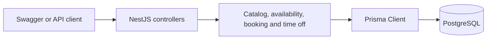

# System design

Each booking reserves a qualified technician and a bay for the entire service. A confirmed appointment saves both assignments in PostgreSQL.

## Structure



Controllers validate requests and return responses. Services handle scheduling rules and transactions. Prisma handles typed queries; a small amount of SQL handles row locks. One application and one database keep scheduling changes easy to coordinate.

| Location | Responsibility |
| --- | --- |
| `src/modules/` | Catalog, availability, appointments and time off |
| `src/common/technician-schedule.ts` | Shared technician locking and conflict checks |
| `prisma/schema.prisma` | Models and relationships |
| `prisma/migrations/` | Tables, indexes and database constraints |
| `test/` | Domain and real PostgreSQL tests |

The client selects a dealership and service, checks availability, then submits the vehicle, customer and desired time. The booking service checks and reserves resources in one transaction, then returns the saved appointment and assigned resource IDs.

## Technology choices

| Tool | Why we use it |
| --- | --- |
| NestJS and TypeScript | Modules separate features; types make dependencies and data easier to follow. |
| Prisma | Generates model types and handles ordinary reads and writes; focused SQL handles locking. |
| PostgreSQL | Transactions, foreign keys and exclusion constraints protect bookings across app instances. |
| Swagger | Gives reviewers a working API interface without building a frontend. |
| Vitest and Testcontainers | Test business rules against real PostgreSQL, including competing transactions. |
| Docker Compose | Runs the API and database together with repeatable setup. |

## Data and scheduling rules

A customer owns vehicles. A dealership offers services and has technicians and bays. Technician skills determine which services they can perform. An appointment links all of these; time-off records belong to a technician.

- Services last 30, 60 or 90 minutes in the demo. All bays support all services.
- Both resources must be free for the **whole** service, including time that crosses midnight.
- All dates and times use **UTC**. An appointment ending at 10:00 allows the next one to start at 10:00.
- Availability offers half-hour start times. Bookings can start at other times too.
- Availability is a preview. Only a saved booking reserves resources.

## Preventing double bookings

PostgreSQL **exclusion constraints** reject rows whose time ranges overlap for the same resource, even when requests reach different app instances.

For example, the technician constraint in the [baseline migration](../prisma/migrations/00000000000000_baseline/migration.sql) is:

```sql
CONSTRAINT appointments_technician_no_overlap EXCLUDE USING gist
  (technician_id WITH =, tstzrange(start_time, end_time, '[)') WITH &&)
  WHERE (status = 'confirmed')
```

`WITH =` matches the technician; `WITH &&` checks overlapping times. `[)` includes the start and excludes the end, so appointments can meet at a boundary. A second constraint protects bays, and a third prevents overlapping absences for one technician.

Foreign keys also enforce vehicle ownership, technician skills, dealership membership and service duration. SQL checks ensure valid intervals and end times. These rules live in SQL migrations because Prisma cannot describe every PostgreSQL constraint.

### Booking and time off must coordinate

Exclusion constraints protect each table separately. They cannot stop an appointment in one table from overlapping time off in another.

Both operations therefore lock the technician row, then check **appointments and time off again after acquiring the lock**. Booking, time-off changes and seed writes all follow this rule. Any additional database writer must do the same.

Booking runs in one transaction:

1. Check the customer, vehicle and offered service.
2. Lock a qualified, available technician and recheck their schedule.
3. Lock an available bay and save the appointment.
4. Commit everything together, or roll everything back.

`FOR UPDATE SKIP LOCKED` lets competing bookings try another resource. Retryable failures get at most five attempts, each in a fresh transaction. Brief contention can still return **409**; the client can retry.

## Safe retries

An optional `Idempotency-Key` identifies one booking request. The key and appointment are saved in the same transaction.

| Request | Result |
| --- | --- |
| First successful booking | **201**, new appointment |
| Same key and same booking | **200**, original appointment |
| Same key with different booking details | **409**, key already used |

Failed bookings do not keep the key. Successful keys survive restarts. Without a key, each request is a separate booking attempt.

## Operating the demo

Docker Compose runs migrations before starting the API and keeps database data in a volume. `/health/live` checks the process; `/health/ready` checks the database and schema. JSON logs include request IDs, and `/metrics` exposes Prometheus metrics.

Use request IDs to follow failures in logs. Request latency, allocation retries and database-error metrics help identify slow requests or booking contention.

## Scaling and performance

App instances can share PostgreSQL because scheduling locks live in the database. Each instance defaults to ten database connections; the total must fit the database's connection budget. Indexes support resource and date lookups, appointment lists are bounded, and availability calculates 48 start times from a consistent schedule snapshot.

We would measure query times and contention before adding caching or more infrastructure. Any cached availability would remain a preview; booking must always recheck the database.

## GenAI in the design

AI helped turn the scheduling requirements into models, API routes and transaction steps. We directed the design toward a single application and database, keeping resource allocation together.

The key design check was whether concurrent requests could save conflicting schedules. This led to database exclusion constraints for bookings and a shared technician lock for booking and time off. Separate constraints cannot enforce a rule across two tables, so both paths recheck the schedule after locking. Real PostgreSQL race tests verify that design.

## Current limits

This demo has no authentication, opening hours, local timezone calendars, cancellation or rescheduling. Time off is a single interval, with no recurrence or approval process. Past bookings are allowed to keep the demo repeatable.

Before public deployment, we would add access controls, protect administrative endpoints, scope booking keys to users and measure behavior under load. The current concurrency tests check correctness, not production capacity.
