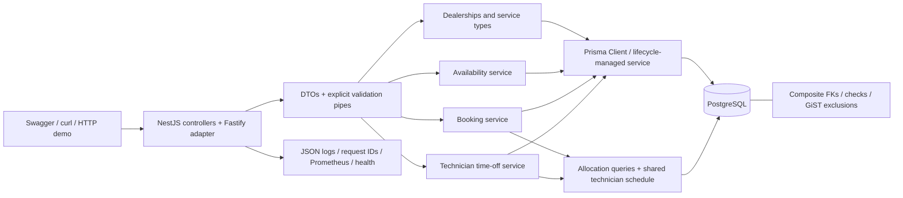
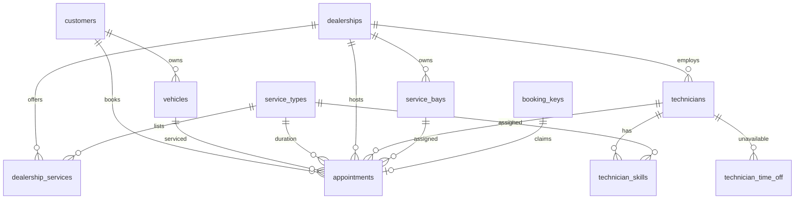

# System design: Unified Service Scheduler

## Problem and scope

Implement Keyloop Scenario A as a persistent REST backend. A customer requests a vehicle, dealership, service and start time; confirmation allocates one qualified technician and one bay for the entire duration and persists all associations. Swagger, cURL and an asserted HTTP demonstration substitute for the client layer.

The implementation now uses NestJS and Prisma and includes technician time off. The framework refactor was verified separately before extending scheduling behavior.

## Assumptions

- Technicians and bays belong to one dealership. Technicians may have multiple service qualifications; all bays support all offered services.
- Services have fixed whole-minute durations (1–1440). Resources can serve one confirmed appointment at a time. Appointments use UTC `[start,end)` intervals; adjacent intervals are allowed.
- Availability shows 48 half-hour starts on a UTC date. This grid is a product assumption; booking can start at any supported RFC3339 instant. Services may finish next day. Past times remain allowed for stable demos.
- Time off is a non-recurring `[startsAt,endsAt)` UTC interval, with optional/null reason (maximum 500 characters at the API). No leave approval or rescheduling is implemented.
- No opening hours, holidays, bay maintenance, payments, cancellation, vehicle/customer collision checks or dealership integrations. Catalog/customer/vehicle administration is seeded.
- Appointment APIs and administrative time-off APIs are unauthenticated assessment endpoints. Production requires identity, object-level/tenant authorization and privileged administration.
- Idempotency applies to booking only. Keys are globally scoped, case-sensitive and retained with successful appointments; failed transactions do not reserve them.

## Architecture and responsibilities

`AppModule` composes feature modules. Controllers own routing and response mapping; services own business decisions and transaction boundaries. `PrismaModule` supplies a lifecycle-managed client through DI. Generated model types cover ordinary reads, relation filters and writes. `AllocationQueries` and `TechnicianSchedule` localize PostgreSQL locking instead of wrapping all Prisma operations in generic repositories. Operations and the exception filter preserve consistent errors and observability.

NestJS makes feature boundaries and dependencies explicit as the scheduler grows. The Fastify adapter retains the existing HTTP engine. Explicit pipes reuse the proven TypeBox/AJV request rules, including strict timestamps, unknown-field rejection and query coercion; DTOs and Swagger decorators document the transport. The new time-off body rejects type coercion. Response mapping excludes private idempotency fields. JSON Schema const/nullability/exclusivity are translated to OpenAPI 3.0 forms.

A modular monolith keeps booking and time off in short PostgreSQL transactions. Stateless application replicas share the same authority; no process-local lock/cache determines scheduling correctness. Microservices would add coordination without an assessment requirement.

## Data model and integrity

Composite foreign keys enforce `(vehicle,customer)`, `(technician,dealership)`, `(bay,dealership)`, `(technician,service)`, `(dealership,service)` and `(service,duration)`. Checks enforce positive duration, correct end time, confirmed-only status and paired idempotency fields. Catalog duration changes are restricted while referenced; future service versioning should preserve historical durations.

Two GiST exclusions prevent overlapping confirmed appointments by technician and bay. A third prevents overlapping time off for each technician. All use half-open timestamp ranges. Time off has a valid-interval check and technician FK. B-tree indexes support dealership/customer/date listing and time-off ordering. `btree_gist` provides UUID equality.

Prisma models map to existing tables/columns. Unsupported exclusions/checks remain in custom migration SQL; see `prisma/README.md`. The original two migrations and checksum ledger remain immutable. Fresh databases execute the Prisma baseline; existing known-schema databases verify legacy checksums/critical exclusions before marking that baseline applied, then deploy new migrations. No data reset, table recreation or db push is used. The upgrade test preserves appointment and idempotency data across adoption. Prisma adds `_prisma_migrations`, bringing the physical table count to 13.

## API and data flow

Discover dealerships → offered services/durations → advisory date availability → POST appointment → GET the returned Location. Existing endpoint paths, JSON fields, statuses, filters and idempotency semantics were retained. Lists sort by startTime/id, have default limit 20, maximum limit 100, bounded offset and hasMore. Date filters select UTC appointment start dates.

Administrative operations:

- GET `/technicians/:id/time-off`: chronological array of time-off records.
- POST `/technicians/:id/time-off`: startsAt, endsAt and optional/null reason; returns 201.
- DELETE `/technicians/:id/time-off/:timeOffId`: validates ownership and returns 204.

Unknown entities return 404, malformed/invalid intervals 400, scheduling conflicts 409. Deleting another technician's record returns 404. Administrative creation has no idempotency key: repeating an overlapping create returns conflict. Admin listing is intentionally simple; pagination/date filters remain future work for large histories.

## Availability workflow

Validate the dealership/offering, derive duration, and read qualified technicians plus overlapping appointments/time off through Prisma relation queries. Read bays and their overlapping appointments in the same REPEATABLE READ transaction. Generate 48 slots in memory; a technician must have no appointment or leave intersecting the full interval, and a bay must independently be free. Relation loading is batched, not a query per slot/resource. The snapshot spans all reads, so technician and bay checks do not mix database states.

Overlap is `existing.start < requested.end AND existing.end > requested.start`. The response exposes only timestamps, service metadata and availability booleans. One occupied technician does not block a slot when another qualified technician and bay remain available. The result is advisory; a committed booking is authoritative. Read volume may eventually justify short-lived availability caching, but booking must always recheck on the primary.

## Booking and shared locking protocol

1. Validate and normalize UUIDs/UTC start; hash a fixed-order payload.
2. Start a Prisma interactive READ COMMITTED transaction. Use only the transaction client inside it; set statement and lock timeouts.
3. For keyed requests, insert the key claim ON CONFLICT DO NOTHING and lock the key row. Identical requests wait for the original transaction. Replay its persisted appointment on equal fingerprint; changed requests return 409. Claim and appointment commit/roll back together.
4. Check customer, vehicle ownership, dealership offering and service duration with Prisma.
5. Select a qualified technician without visible appointment/time-off overlaps, ordered by UUID, using FOR UPDATE SKIP LOCKED. **After acquiring the lock, issue fresh Prisma queries against both appointments and time off.** If eligibility changed, roll back and retry allocation.
6. Lock an eligible bay in deterministic order, then create the appointment through Prisma. The database enforces all exclusions/FKs/checks. Commit and return 201.
7. On a retryable SQLSTATE or changed selection, start a fresh transaction, at most five attempts. Never query inside an aborted transaction. Exhaustion returns an allocation conflict; clients back off and retry with the same key.

Idempotency replay returns 200 and Idempotency-Replayed:true; initial success returns 201 and Location. UUID case, field order and equivalent timezone offsets normalize consistently. Replays return mapped immutable appointment data, not private fingerprints. Crash-before-commit rolls back the claim; crash-after-commit is recovered by keyed retry.

## Time-off transactions and cross-table races

Time-off creation locks the specified technician row with FOR UPDATE, then rechecks **both** tables in fresh statements before inserting. It returns 409 for an existing appointment or leave overlap. Deletion locks the same row and deletes only the matching technician's record. Seed time-off writes use the same lock/recheck protocol. Serialization/deadlock/lock-timeout failures get at most five fresh transactions; exclusion violations become scheduling conflicts.

For booking-first, time off waits on the technician row; after booking commits, its fresh check sees the appointment and rejects leave. For time-off-first, booking skips the locked technician or, after a completed lock holder, sees the committed absence and selects another qualified resource. Two time-off creates serialize on that row and the second sees the first interval. Appointment and time-off exclusions still defend each table against incompatible direct writes.

**The cross-table guarantee requires all writers to follow this protocol.** Independent exclusions cannot protect arbitrary SQL inserting into two different tables. Production should restrict direct writes or add database enforcement if other writers are introduced.

Lock order is booking key → technician → bay; time-off mutations use technician only. This reduces deadlocks without claiming they are impossible. SKIP LOCKED can conservatively return conflict while an otherwise usable resource is briefly locked, even for another time. Deterministic ordering can favor low-ID technicians. Those are documented trade-offs; fair scheduling/admission control and measured load tuning remain future work.

## Reliability, performance and observability

Application replicas are stateless. Each Prisma adapter pool defaults to ten connections with connection/query/statement limits; size replica pools against the database budget. Interactive transaction max-wait/timeout limits and bounded retries limit contention; they do not establish an end-to-end latency SLO. Exclusion and B-tree indexes support resource overlap and bounded lists. Availability loads the day's relevant resource schedules; large dealerships need query-plan/load measurements and possibly pagination or a more specialized query.

Compose runs a migration job before the non-root API, persists PostgreSQL in its named volume and checks schema-aware readiness separately from liveness. Nest shutdown hooks drain the server and disconnect Prisma. Production needs migration/runtime role separation, shutdown deadlines, backups, restore/failover drills, HA and deployment compatibility planning. The compact demo image includes Prisma CLI for migration commands; separating that into a deployment job/image would reduce production runtime size.

Preserved: Pino JSON request logs, generated X-Request-Id, a common `{error:{code,message,requestId}}` contract, latency by route/method/status, booking outcome counts, allocation retries and database error codes. Logs omit bodies/query strings and redact auth/cookies/idempotency keys. Error translation handles Prisma and SQLSTATE wrappers without exposing SQL/customer details. Metrics use route templates rather than identifiers.

Future operations: private Prometheus scraping, latency/error/saturation SLOs, conflict/DB outage alerts and OpenTelemetry spans across HTTP/services/Prisma. No tracing collector, alert manager, dashboard or production throughput claim is implemented.

## Choices, security and future evolution

NestJS supplies module/controller/service conventions and DI; Prisma supplies generated types, autocomplete, relation filtering and ordinary writes. Raw SQL remains necessary for FOR UPDATE/SKIP LOCKED, key coordination and custom PostgreSQL constraints. PostgreSQL, rather than ORM convenience, remains the consistency boundary. Vitest and Testcontainers validate actual database behavior; mocks do not replace transaction tests. Docker Compose is sufficient local infrastructure.

This is an unauthenticated local assessment demo. Production requires identity, dealership/customer/tenant authorization, privileged time-off operations, scoped/expiring booking keys, rate limits, TLS/secret injection, least-privilege DB roles, privacy controls and protected metrics/docs. UUIDs are identifiers, not secrets. Time-off reasons may be sensitive and should not be exposed through public availability or request logs.

Next product steps: administrative authorization, local dealership calendars/timezones/DST policy, resource maintenance, cancellation/rescheduling and audit history. Add service versioning and an outbox for reliable notifications/integrations when required. Keep dealership adapters as modules until team/failure boundaries justify extraction. Measure primary database capacity before partitioning by dealership or adding infrastructure.

## GenAI collaboration and verification

The human supplied the assessment, initial requirements and stack, then requested NestJS/Prisma and time off with an explicit shared-lock protocol. After receiving the proposal, the human authorized autonomous implementation/technical decisions/commits and deferred review. The agent preserved and reran the original behavior tests before starting Phase 2, compared real old/new API responses, tested populated migration adoption, and added deterministic PostgreSQL race gates and rollback/retry fault injection for time off. Observed corrections and actual final counts are in `docs/refactor-verification.md`. No human code review, test execution, production validation or video recording is invented; final acceptance/submission remain with the human.
